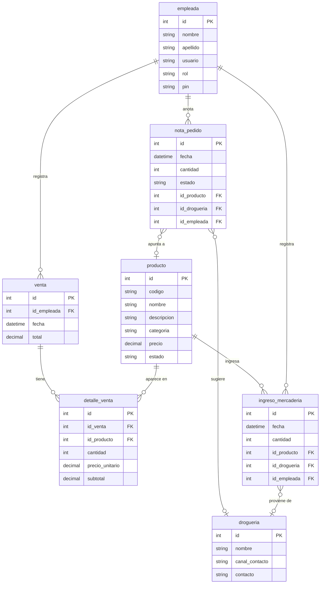

# 01 - Diagrama Entidad-Relación (versión final)

Fuente: `Der_FarmaTech.pdf`. Roles definidos en el DER: **Empleada** y **Encargada**.

Nota: los tipos de dato (`int`, `string`, `datetime`, `decimal`) son indicativos, ya que el DER del PDF solo indica nombres y claves. En el PDF `detalle_venta.id_producto` no lleva la marca FK, pero la relación con `producto` está dibujada; se lo marca como FK.

## Relaciones

| Relación | Enunciado en el DER |
|---|---|
| detalle_venta - venta | Cada detalle pertenece a una venta - una venta tiene muchos detalles |
| detalle_venta - producto | Cada detalle apunta a un producto - un producto puede estar en muchos detalles |
| venta - empleada | Cada venta la registró una empleada - una empleada hace muchas ventas |
| nota_pedido - producto | Cada nota puede apuntar a un producto - un producto puede estar en muchas notas |
| nota_pedido - empleada | Cada nota la anotó una empleada - una empleada anota muchas notas |
| nota_pedido - drogueria | Cada nota puede tener una droguería sugerida - una droguería puede estar en muchas notas |
| ingreso_mercaderia - producto | Cada ingreso es de un producto - un producto puede ingresar muchas veces |
| ingreso_mercaderia - drogueria | Cada ingreso puede venir de una droguería; una droguería provee muchos ingresos |
| ingreso_mercaderia - empleada | Cada ingreso lo registró una empleada - una empleada registra muchos ingresos |

Las relaciones con "puede" en el enunciado (nota - producto, nota - drogueria, ingreso - drogueria) se modelan como opcionales (`o|`); el resto son obligatorias.

Observación: en el dibujo del PDF las líneas de esas tres relaciones muestran el marcador de "uno obligatorio" del lado del producto o la droguería, lo que difiere del texto "puede". Se tomó el texto como criterio. Conviene confirmarlo con el cliente o el docente.

## Correspondencia con la implementación

- `empleada.usuario`, `empleada.pin` y `empleada.rol` se resuelven con ASP.NET Identity: el usuario corresponde a `UserName`, el PIN se guarda como hash de contraseña (no en texto plano) y el rol se maneja con los roles `Empleada` y `Encargada`.
- Las demás tablas se acceden mediante `AppDbContext` sobre SQL Server (proyecto `FarmaTech.BD`).
