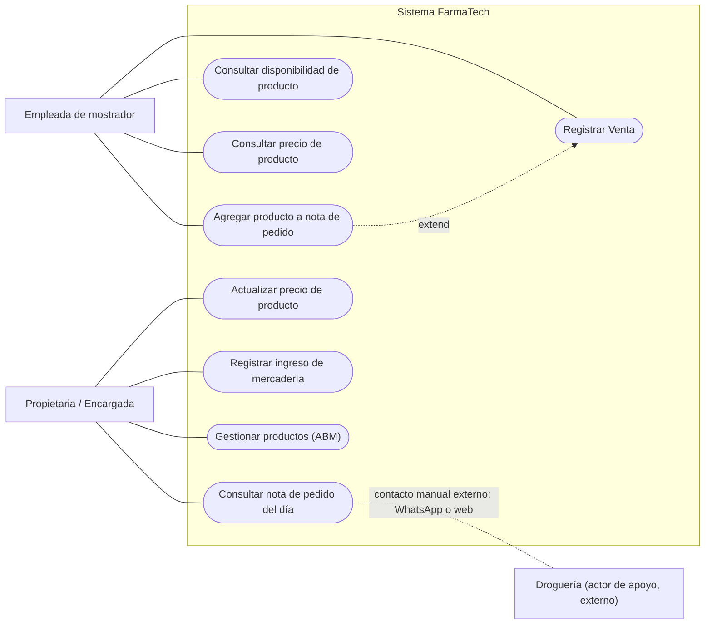

# 02 - Diagrama de casos de uso

Mermaid no ofrece diagramas UML de casos de uso nativos; se representa con un `flowchart`: los actores son nodos y los casos de uso son nodos ovalados dentro del límite del sistema.

## Actores y objetivos

| Actor | Objetivos |
|---|---|
| Empleada de mostrador | Registrar venta de un producto, consultar precio de un producto, agregar producto faltante a la nota de pedido |
| Propietaria / Encargada | Gestionar productos (ABM), actualizar precio de un producto, registrar ingreso de mercadería, consultar nota de pedido del día |
| Droguería | Recibir pedidos de reposición (de forma externa al sistema) |

Notas:

- "Agregar producto a nota de pedido" extiende a "Registrar Venta": se accede desde la misma pantalla de búsqueda cuando el producto no está disponible.
- La Droguería es un actor de apoyo pasivo: no interactúa con el sistema; recibe los pedidos por canales externos (WhatsApp o web) y la encargada los arma usando la nota de pedido como referencia. La línea punteada indica ese contacto manual, no una función del sistema.
- "Consultar disponibilidad de producto" se asigna a la empleada de mostrador: la entrevista confirma que es ella quien busca el producto y detecta si no está.
- Los roles del DER son Empleada y Encargada. La Encargada también realiza los casos de la empleada (confirmado en las preguntas complementarias de [03-preguntas-al-cliente.md](03-preguntas-al-cliente.md)).

## Elementos eliminados respecto a la versión anterior

- Actor **Sistema**: ya no emite alertas automáticas.
- Objetivos de la encargada **"Consultar catálogo de droguería"** y **"Generar pedido a droguería"**: quedaron fuera del alcance.
