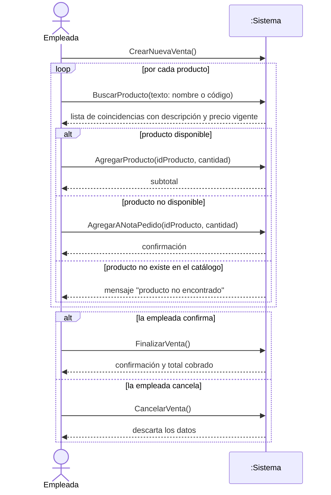
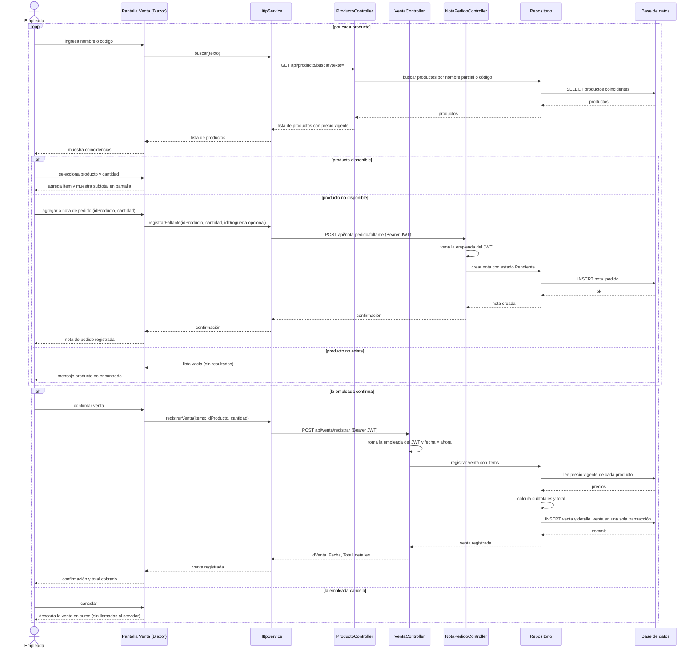

# 05 - Diagramas de secuencia: Registrar Venta

## 1. Diagrama de secuencia del sistema (nivel de análisis)

Muestra la interacción entre la Empleada y el sistema tratado como una caja negra (`:Sistema`).

**Explicación.** La empleada inicia la venta y, por cada producto, busca por nombre parcial o código. Según el resultado: lo agrega a la venta (disponible), lo anota en la nota de pedido (no disponible) o recibe el aviso de que no existe en el catálogo. Al terminar, confirma la venta y recibe el total, o la cancela y no se registra nada.

**Cambios respecto a la versión anterior** (`CrearNuevaVenta()`, `BuscarArticulo(id)`, `ConfirmarCantidad(cantidad)`, `FinalizarVenta()`):

- `BuscarArticulo(id)` pasa a `BuscarProducto(texto)`: búsqueda por nombre parcial o código, con lista de coincidencias.
- `ConfirmarCantidad(cantidad)` pasa a `AgregarProducto(idProducto, cantidad)`, que devuelve el subtotal.
- Se agrega un `loop` porque una venta puede tener varios productos.
- Se agregan `AgregarANotaPedido` (producto no disponible) y el mensaje de producto no encontrado (no existe en el catálogo).
- Se agrega `CancelarVenta()`.

## 2. Diagrama de secuencia de diseño

Usa los endpoints reales de la API. Capas: cliente Blazor WASM (`FarmaTech.Cliente`), `HttpService` (`FarmaTech.Servicios`), controladores (`FarmaTech.Server`), repositorios (`FarmaTech.Repository`) y `AppDbContext` sobre SQL Server (`FarmaTech.BD`).

**Explicación.**

- La búsqueda usa `GET api/producto/buscar?texto=` (parcial por nombre o código). También existe `GET api/producto/codigo/{codigo}` para búsqueda exacta por código, que sigue el mismo recorrido.
- Los ítems se acumulan en la pantalla; no se persiste nada hasta confirmar.
- El cliente envía solo `IdProducto` y `Cantidad`. El servidor toma el precio vigente de la base de datos, calcula subtotales y total, obtiene la empleada del JWT, usa la fecha actual y guarda venta y detalles en una única transacción. Responde `IdVenta`, `Fecha`, `Total` y los detalles.
- `POST api/nota-pedido/faltante` (cuerpo: `IdProducto`, `Cantidad`, `IdDrogueria` opcional) crea la nota con estado `Pendiente` y la empleada tomada del JWT. Ambos POST requieren autorización.
- Cancelar no genera llamadas al servidor porque la venta aún no fue persistida.

**Diferencias con el diagrama de análisis.** El de análisis oculta las capas; el de diseño agrega la entrega del precio desde la base de datos (nunca desde el cliente) y la transacción única, y deja explícito que "producto no existe" es un resultado vacío de la búsqueda.
